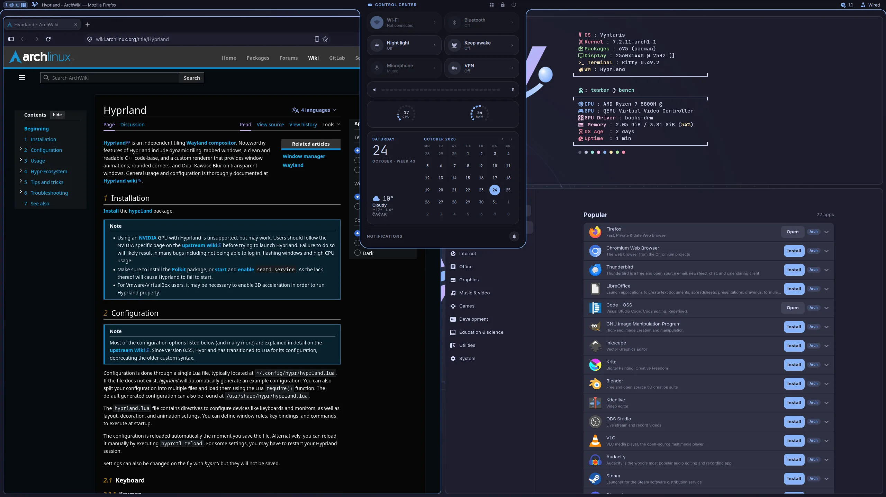
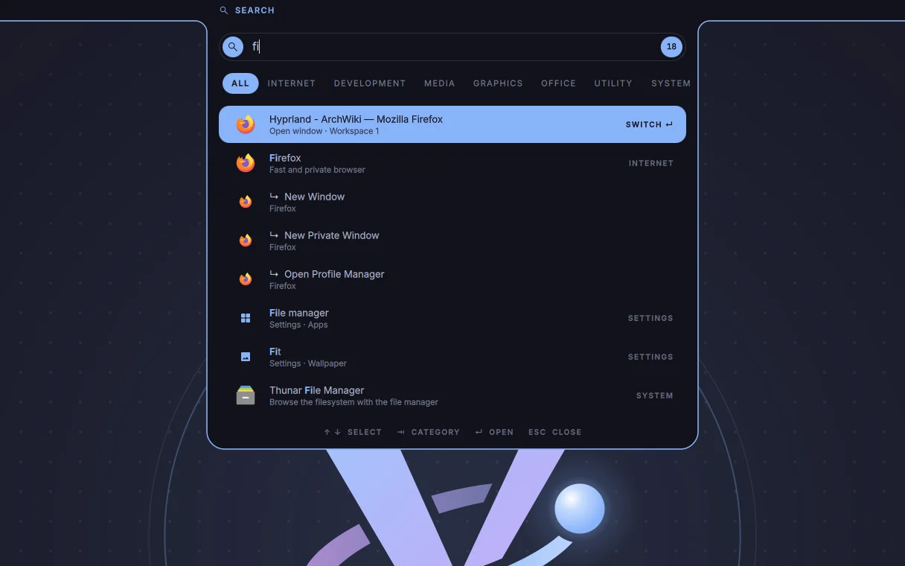
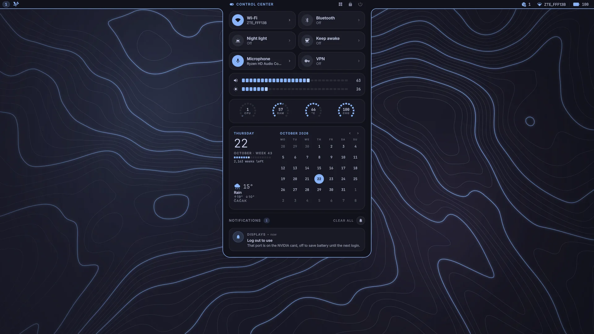
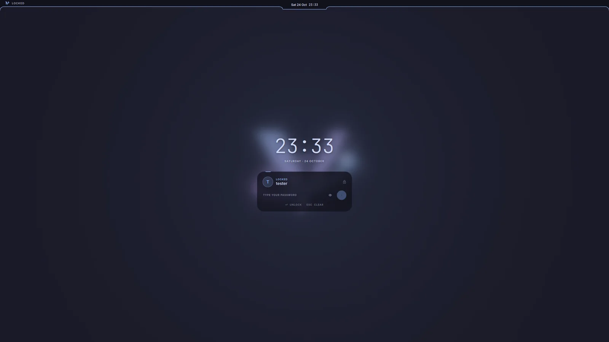
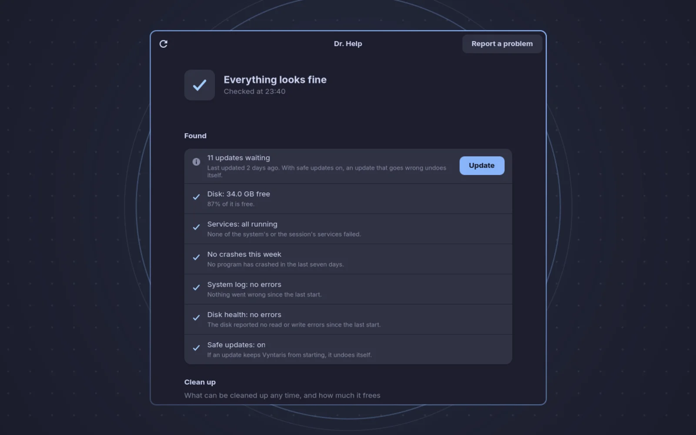
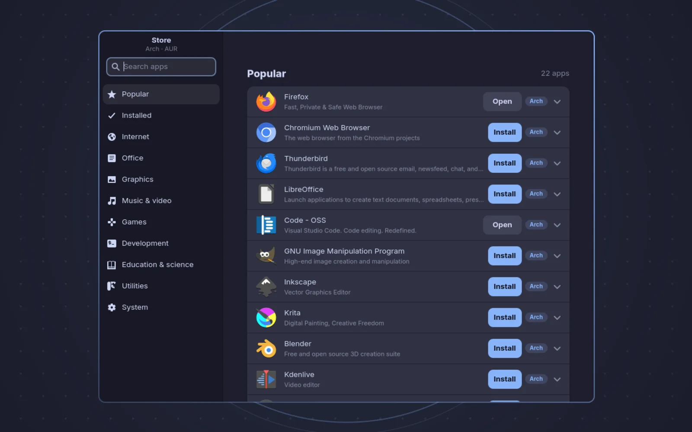
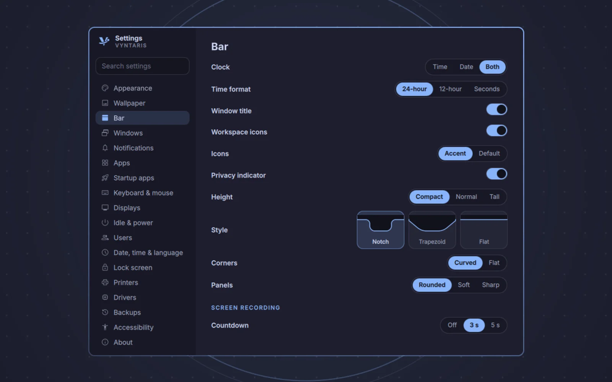

# Vyntaris

Vyntaris is a desktop operating system built on Arch Linux. Its desktop is Hyprland (the compositor) and
a shell of its own written in Quickshell: a bar along the top with an **island** in its middle that grows
into the launcher, the control center, notifications, the sound panel, the media player, the power menu,
the wallpaper picker, the window switcher and more. One accent colour and one light or dark flavour
(Catppuccin) run through all of it: the shell, GTK and Qt apps, Firefox, VS Code, the terminal, the icons,
the login screen and the boot splash.

Vyntaris is at 0.2.0, a beta for early testers. Problems and ideas go to
[the issue tracker](https://github.com/vyntaris/vyntaris/issues).

Underneath it stays plain Arch: a rolling release from Arch's own repositories, updated with
`pacman -Syu` or one click in the island. Vyntaris itself is one package, `vyntaris`, from its own
signed repository.



| | |
|---|---|
|  |  |
| The launcher: apps, windows, settings and files | The control center: tap SUPER |
|  |  |
| The lock screen | Dr. Help, which looks the system over and fixes it |
|  |  |
| The Store | Settings, every one of them searchable |

This README goes through the whole system, from the moment the computer starts to the last setting:
what each part does, how it works and where it lives.

- [How a start goes](#how-a-start-goes)
- [Settings: one file](#settings-one-file)
- [The shell](#the-shell)
- [Colours and themes](#colours-and-themes)
- [Sound](#sound)
- [Network, Bluetooth and the phone](#network-bluetooth-and-the-phone)
- [Apps of its own](#apps-of-its-own)
- [Everyday apps](#everyday-apps)
- [Keeping the system healthy](#keeping-the-system-healthy)
- [Safe updates](#safe-updates)
- [Drivers, firmware and games](#drivers-firmware-and-games)
- [Security and privacy](#security-and-privacy)
- [Install](#install)
- [Releases and testing](#releases-and-testing)
- [Keys](#keys)
- [Layout of this repository](#layout-of-this-repository)

---

## How a start goes

1. **Boot.** systemd-boot starts a unified kernel image (UKI). The kernel command line is quiet and the
   Plymouth boot splash shows the Vyntaris mark arriving out of warp, its planet going round the orbit,
   in your accent and flavour (`rust/tools/splash` draws its frames; `vyntaris-splash` draws them again
   when the colours change). Without a boot menu by default; one entry appears when an update needs a
   way back (see [Safe updates](#safe-updates)).
2. **Login screen.** greetd runs a small Hyprland (`system/greetd/hyprland.lua`, on the integrated GPU
   only on a hybrid laptop) with the greeter, a Quickshell config of its own (`config/greeter`) that
   shares the lock screen's face (`components/LockFace.qml`). `vyntaris-greeter-sync@` keeps its
   wallpaper, colours and user picture in step with the user's desktop whenever they change. The
   desktop's own user services don't start for the `greeter` account (`system/greetd/not-for-greeter.conf`):
   it has no home to keep anything in, so the shell would take every boot for a first start.
   `--autologin` skips it and logs in on tty1 instead.
3. **Session.** `vyntaris-session` starts Hyprland with Vyntaris's configuration
   (`/usr/share/vyntaris/hypr/hyprland.lua`, written in Lua). It watches over it: a Hyprland that
   crashes is started again as itself and says so; one that keeps crashing goes back to the login
   screen. Hyprland's own "safe mode", error bar, logo and "not responding" box never show.
4. **Services.** Hyprland starts `vyntaris-session.target`, and with it the session's user services,
   each restarted if it fails:

   | Service | What |
   |---|---|
   | `vyntaris-shell` | the shell: bar, island, notifications, lock screen, OSD (`qs -c vyntaris`) |
   | `vyntaris-wallpaper` | awww, which draws the wallpaper without the GPU; the shell tells it which |
   | `vyntaris-cliphist-text`, `-image` | clipboard history for the launcher (`: ` in the search) |
   | `vyntaris-doc-index` (+ timer) | the index of what's inside your documents, for the launcher |
   | `vyntaris-user-setup` | once per Vyntaris version: your folders and app defaults |
   | `vyntaris-obex-agent` | while Bluetooth is on: asks before accepting files sent to this computer |
   | `vyntaris-phone` | once turned on: the phone link |

   hypridle and hyprsunset (night light) are run by the shell, which writes their settings from yours.
   hypridle's defaults are:

   - dim after 2½ minutes;
   - lock after 5;
   - screen off after 5½;
   - sleep after 30.

   Closing the lid suspends. The battery warns at 20 % and again at 5 %. At 20 % the power saver also
   comes on and the screen dims a little; both go back when the charger is plugged in, even with the desktop
   restarted in between (what they were is kept in `~/.local/state/vyntaris/power-saver-before`).

   Night light is 4000 K. It can come on by itself between 20:00 and 07:00.

**The watchdog.** `vyntaris-session` replaces Hyprland's own `start-hyprland`, which would restart a
crashed desktop in Hyprland's bare "safe mode".

- A Hyprland that crashes is started again with Vyntaris's config, and says so.
- Three crashes in five minutes and it goes back to the login screen.
- Logging out, restarting and shutting down are marked by the power menu (`Leaving.qml`), so they're
  never taken for a crash.
- What it prints goes to a log, never onto the console.

---

## Settings: one file

Everything that is yours lives in **`~/.config/quickshell/settings.json`**: the theme, the bar, windows,
keyboard and mouse, displays, idle and power, night light, game mode, the weather's city, your birthday
for memento mori, the noise suppression level and the rest. It's created with defaults on the first start
and edited by the Settings app (SUPER+I); editing it by hand works too.

Every part of the system reads the same file:

- the shell (`config/quickshell/config/Config.qml`), which watches it and applies a change at once;
- Hyprland (`config/hypr/lib/settings.lua`), reloaded by the shell after a change. A value of the wrong
  kind (a word where a number belongs) is left out rather than taking the config down; a file that can't
  be read is kept as `settings.json.broken` and the defaults are used;
- the Rust tools (`rust/core`: the palettes, the accent, paths) and the shell scripts (`rust/tools/json`);
- the login screen, through `vyntaris-greeter-sync`.

Your own Hyprland additions go in `~/.config/hypr/user.lua`, loaded after Vyntaris's. A mistake in either
file shows as a Vyntaris notification.

---

## The shell

The shell is the whole visible desktop: `config/quickshell`, started from `shell.qml`. It is written in
QML on Quickshell: `modules/` hold what's drawn, `services/` hold what's known (one singleton each:
Battery, Notifications, Weather, AudioDevices, Updates, …), `components/` the pieces they share,
`config/` the settings, the theme and the palettes.

### The bar and the island

The bar runs along the top: on the left the Vyntaris mark and the workspaces (numbers, or the apps open on
each, with a live preview on hover), on the right the tray, the privacy dot, Bluetooth headphones'
battery, Wi-Fi, the battery. In the middle hangs the island, which shows the clock and grows into each
panel as it opens, then goes back into the clock. Only one panel is open at a time; Esc or a click
anywhere else closes it.

The island's views (`modules/island/`):

| View | What it shows |
|---|---|
| **Control center** (tap SUPER) | Wi-Fi, Bluetooth, night light, keep awake, the microphone and game mode as tiles, each with an arrow to its own panel; volume and brightness; processor, memory, temperature and charge; the music playing; the month with today's date, the week of the year, the weather and memento mori; the notifications. Typing while it's open turns it into the search. |
| **Launcher** | apps, open windows, settings and files, searched as you type (see below) |
| **Apps** (SUPER+A) | every app as a grid, narrowed as you type, TAB through categories |
| **Sound** (SUPER+SHIFT+A) | the output and input in use, their volume, every other device, noise suppression |
| **Wi-Fi**, **Bluetooth** | networks and devices: connect, pair, forget, the password asked in the island |
| **Night light**, **Game mode**, **Keep awake** | their settings, from the tiles' arrows |
| **Media** | the player: cover, progress, controls, every app playing |
| **Wallpapers** (SUPER+W) | the wallpapers under the bar, ← → to browse, Enter to set and close |
| **Overview** (ALT+TAB) | the open windows; hold ALT, TAB picks, letting go of ALT goes there |
| **Power** (SUPER+ESC) | lock, sleep, hibernate, restart, shut down, log out |
| **Timer** (SUPER+T) | a timer and a stopwatch |
| **Updates** | what's waiting, firmware too; Update needs no terminal |
| **Packages** | an install as its terminal shows it (click an install's activity) |
| **Capture** | screenshot or record a region or the screen |
| **Battery**, **System**, **Keyboard**, **Phone**, **Privacy** | as their names say |

**Live activities.** While something goes on, the clock shares the island with it: a download's speed, a
timer, a stopwatch, a countdown before recording, a charging laptop, packages installing (counted from
pacman's log, and one banner at the end only for what really completed; clicking it shows the kitty
window's screen pacman runs in, through `kitty @ get-text`). Banners say when something finishes.

**Notifications** come in the island and stay in the control center, grouped by app, swiped aside to
dismiss. Do not disturb keeps them quiet; game mode can too. Timeshift's own notifications are dropped
while pacman runs, as the island already shows the update.

**OSD.** Volume, brightness, the keyboard layout, airplane mode and the like show briefly in the island
when they change, from a key or the screen's edges (scrolling on the right edge sets the volume, on the
left the brightness).

### The launcher

Tap SUPER and type. It finds apps (by name, by what they do), open windows, settings by their title
("Warmth", "Lid") or by words they're known by ("dark", "battery"), and files: by name, and by what's
inside PDFs, Office documents and text files (`rust/tools/doc-index` keeps an index of Documents,
Desktop and Downloads up to date in the background).

It also understands plain words (`modules/island/Search.js`), in English and in the interface's language
(Serbian, German, French, Spanish, Italian, Portuguese, Polish: `isključi bluetooth`, `lautstärke 40`, typed with
accents or without; a phrasebook makes them English, then they're understood as English is): `turn bluetooth off`, `volume 40`,
`brightness 70`, `dark mode`, `sound`, `display settings`, `check my system`, `lock`, `restart`;
sums and units (`12*7`, `5 km to mi`); money (`100 eur to rsd`, rates from open.er-api.com, fetched only
when asked and kept 12 hours); a timer (`timer 5m`). Prefixes switch modes: `>` runs a command, `:` the
clipboard history, `;` emoji, `/` files. When it finds nothing, "Search the Store" is one Enter away.

What it opens (and the app grid, and the startup apps) runs in a scope of its own beside the other apps
(`app.slice`, `Config.openEntry()`), as the app keys' do: never in the shell's service, which would close
it whenever the shell restarts, as it does with every update.

### The control center's calendar and weather

The month is drawn by `components/MonthCalendar.qml`: Monday first, six weeks always (it keeps its height
from month to month), today as a filled circle, any day picked and said in full with how far it is.
Beside it, `TodayWeather.qml` shows today large, the week of the year, then:

- **Memento mori**: with a birthday set (Settings → Date, time & language, or the welcome), the weeks
  left until 70 and how much of it is lived, as a row of markers;
- **The weather** (`services/Weather.qml`): from Open-Meteo (free, no account, no key), the weather now
  and today's highest and lowest, read when the control center opens and at most every half hour. The
  city is the time zone's unless one is picked: the picker searches Open-Meteo's places as you type and
  keeps where the city is, so another place of the same name isn't taken. Without the internet, the last
  one read.

Their sizes come from the theme's font size, none fixed, and the two sides line up with each other to the
pixel: today's name with the month's, the city's baseline with the last week's numbers.

### Lock screen

SUPER+L, idle, the lid, or before sleep. It's Wayland's session lock, so nothing shows through it: the
wallpaper blurred, a large clock, the password card with the user's picture, the battery, the keyboard
layout, and widgets (music controls, the unread notifications) that can be turned off. The password field
takes the keys again whenever the screen's window comes back, after a suspend or hibernation too.

### Other parts of the shell

- **Quick Look**: Space on a file in Thunar shows it without opening an app (pictures, PDFs, video, music,
  Word, Excel as a table, PowerPoint, OpenDocument, text, a folder); ← → go through the folder.
- **Privacy**: a dot in the bar while an app uses the microphone, a camera or the screen; its panel names
  the app and can close it. The desktop's own passive links (the noise filter) don't count.
- **Screenshots and recording**: a region is drawn over the dimmed screen; the picture goes to Pictures and
  the clipboard. Recording shows a countdown, then a stop in the island.
- **Password prompts** for administrator rights are the shell's own (a polkit agent), in the lock screen's
  style.
- **Screen sharing** asks in `vyntaris-share-picker` (a GTK app): a screen, a window, or a part of the
  screen.
- **Welcome** (first start, or Settings → About): mode, accent and wallpaper; the desktop's look; keyboard
  and time; you (the weather's city and a birthday); the internet; extras.

### Languages

The shell speaks the system's language (Settings → Date, time & language, from the next login): English,
Serbian (Latin), German, French, Spanish, Italian, Portuguese and Polish. Every text is written in English in
the code through `Tr.t()` (`config/Tr.qml`) and found in `i18n/LANG.json`; one not translated yet stays
English. Dates are the language's own. The installer changes language as soon as one is picked, and
Vyntaris's own apps (Dr. Help and its findings, the Store, Backup, the share picker) read the same translations
through `vyntaris_core::i18n` (`tr()`, `trf!()`); the problem report Dr. Help sends stays English, for
Vyntaris's developers. `tools/i18n.py` checks the translations (CI) and lists what a language lacks;
`VYNTARIS_LANG=de` tries one without changing the system's.

### Settings

Settings (SUPER+I) is the shell's own, running in a process of its own (`settings.qml`,
`modules/settings`). Pages: Appearance, Wallpaper, Bar, Notifications, Windows, Startup apps, Apps,
Keyboard & mouse, Displays, Idle & power, Users, Date, time & language, Lock screen, Printers, Drivers,
Backups, Accessibility, About. Ctrl+F searches every setting; so does the launcher, which opens Settings
on the setting's page with the setting flashing. What needs root (users, the language) goes through
`rust/tools/settings-admin` via pkexec, each change checked. Night light and game mode are set in the
island, from their tiles. Help (`help.qml`) lists every shortcut, read from Hyprland itself.

---

## Colours and themes

The palettes are Catppuccin's: Mocha (dark) and Latte (light), with fourteen accents (Blue by default in
the dark, Sky in the light). Light and dark can follow the time of day. The accent can also come from the wallpaper, and the
wallpaper can tint the panels.

When the accent or the flavour changes, the shell (`modules/theme/AppTheme.qml`) writes the colours to
every place that needs them:

- **GTK 3 and 4** (`~/.config/gtk-*.0/gtk.css`, adw-gtk3) and **Qt** (qt6ct);
- **kitty** (`~/.config/kitty/theme.conf`, included by your `kitty.conf`, which includes Vyntaris's);
- **Firefox** (its `userChrome.css` takes the accent from the system, live) and **VS Code**
  (`rust/tools/vscode-theme`: Catppuccin's theme and its accent, the rest of your settings left alone);
- **icons**: `rust/tools/icon-theme` makes `~/.local/share/icons/Vyntaris`, Papirus with its folders
  redrawn in the accent and the apps in their own colours. It's a theme of its own linking to Papirus's
  files, not one inheriting all of Papirus: every GTK 4 app indexes a theme's icons as it starts (twice),
  and Papirus's 165,000 (the icons of some 8,400 apps, in every size) took 0.3 s each time. It keeps the
  symbolic, device, status, file type and emblem icons, the folders (not Papirus's 25 other colours of
  them), toolbar and tray icons at 16 to 24 px, and of the apps' icons the installed apps' and the generic
  ones: some 37,000, 36 ms, the calculator open in 0.34 s instead of 1.1. It's written again when apps
  come or go (AppTheme.qml); an icon it lacks comes from Adwaita and hicolor;
- **every app that asks**: `rust/daemons/portal` answers the XDG Settings portal with the accent and
  whether it's dark, and tells apps when either changes;
- **Hyprland's** window borders (an accent gradient), the **login screen** and the **boot splash**.

The Vyntaris wallpapers, Minimal (the mark on a faint dot grid) and Terrain (a contour map), are drawn
again in the accent and the flavour each time either changes (`config/AccentWallpaper.qml`), from vector
scenes (`WallpaperArt.js`, rendered by rsvg-convert). Your own pictures go in `~/Pictures/Wallpapers`. One
picture is shipped, `default.png`, Minimal in the default accent (`tools/make-default-wallpaper.sh`): the
login screen's and the installer's.

The workspaces' app icons in the bar can be in the accent or in their own colours (Settings → Bar →
Icons).

**The shape** is the *Style* on Settings → Bar (and in the welcome), each style one whole look
(`components/BarStyles.js`), so no mix of settings makes it half one thing and half another:

| Style | The island |
|---|---|
| **Notch** | hangs from the bar with rounded shoulders |
| **Trapezoid** | wider at the bar, its sides leaning |
| **Flat** | sits inside the bar at rest, its line straight across; grows down when it opens |

*Corners* (Curved, Flat), beside it with any style, is where the bar meets the screen's sides: its
line curving down them (slanting, with a trapezoid), or stopping straight at them.

*Panels* (Rounded, Soft, Sharp), with any style, is how round what's inside the panels is: their
tiles, buttons, fields and lists (`Theme.r()`), and the windows' corners: Sharp makes them square, Soft half as
round as Settings → Windows → Rounding. The island's own shape is left as it is. Circles
(dots, discs, pictures) stay circles. With a trapezoid the bar's ends slant at the lean of its sides, and on its
panels everything goes by the sides as the quick settings do: each block (a row, a tile grid, a card) is set
at the panel's side where it ends, the same gap, and its surface (and what's hovered) runs along the side up
to its top (`components/PanelBody.qml`, `components/Slanted.qml`).

---

## Sound

PipeWire with WirePlumber. The volume keys, the screen's right edge and the control center set the
volume; **Sound** (SUPER+SHIFT+A, the volume's arrow, the microphone tile's arrow, or typing `sound`)
lists where sound goes and comes from, as a person thinks of it (`services/AudioDevices.qml`): each
card's outputs and inputs (speakers, headphones, HDMI / DisplayPort, a microphone), Bluetooth and USB
devices, and virtual ones. Picking one turns its card's profile on when needed (a monitor's HDMI sound,
whose card is off), sets its port and makes it the default. What's taken over by something plugged in
(the speakers while headphones are in) shows as Off.

**Noise suppression** for the microphone (`services/NoiseSuppression.qml`) comes in four steps. It runs
RNNoise (`noise-suppression-for-voice`, installed the first time it's turned on) in a PipeWire
filter-chain, which gives a microphone of its own: the real one without its noise, the default while
it's on.

- **How it's set up.** The filter-chain is written to
  `~/.config/pipewire/filter-chain.conf.d/vyntaris-noise.conf`. It is RNNoise's LADSPA plugin
  (`noise_suppressor_mono`) on the microphone you picked (`audio.noiseMic`, or the default).
- **The steps.** Step 1 removes noise only. Steps 2, 3 and 4 also silence whatever RNNoise is less
  than 60, 85 or 95 % sure is a voice (its VAD threshold, with a 200 ms grace period): typing, a fan,
  the crackle between words.
- **Turning it off** removes the file, and the real microphone is the default again.
- **Privacy** doesn't count the filter as an app using the microphone.

Login and notification sounds are made by `tools/make-sounds.py`: Chime, Bloom and Halo at login, and a
choice of notification sounds.

---

## Network, Bluetooth and the phone

- **NetworkManager** for Wi-Fi and cable; the Wi-Fi panel connects, asks for a password in the island and
  forgets networks. Airplane mode is what's turned on as it (its tile, the laptop's key, a hardware
  switch), not every radio happening to be off.
- **Bluetooth** (BlueZ): pairing and connecting in the island, headphones' battery in the bar, files
  received only after asking (`vyntaris-obex-agent`, saved to Downloads) and sent from Thunar
  (`vyntaris-bt-send`).
- **The phone link** (`rust/daemons/phone`): this computer's side of KDE Connect's protocol, written for
  Vyntaris (nothing of KDE's is installed), with the KDE Connect app on the phone. The phone's battery in
  the bar and its notifications on the desktop, one clipboard for both, find my phone, files both ways,
  and the phone as a touchpad, keyboard and remote. It's off until turned on, as it makes the computer
  visible on the network.
- **Printers** with CUPS (Settings → Printers), found on the network through Avahi; their drivers install
  by themselves. **Scanners** work with Simple Scan.

---

## Apps of its own

The apps written for Vyntaris are GTK 4 and libadwaita apps in Rust (`rust/apps`), in the desktop's
colours as they change (`rust/ui`), each started once (a second start shows the first), and kept for two
minutes after they're closed so opening them again is instant.

### Backup

Backup (`rust/apps/backup`) copies the folders picked to "Vyntaris backup" on your Google Drive, through
`vyntaris-cloud-backup` (rclone): at every start, as the computer shuts down, or only by hand. It shows how
the last backup went, the one under way and how far it has got, the Drive's space, and the backup to take
files back from. What it sets (when, which folders) is the shell's settings, so the island and the leaving
screen follow it.

### Dr. Help

Dr. Help looks the system over the way the Arch Wiki's System maintenance page asks. It says what it
found in plain words, worst first, and puts a fix next to whatever it can put right. Open it from the
launcher, or type `check my system`.

It comes in two parts:

- **`rust/tools/doctor`** (`/usr/lib/vyntaris/doctor`) does the work. It is a command-line tool that
  speaks JSON.
- **`rust/apps/health`** is the GTK app that shows the results. It looks again each time it's opened,
  at most once a minute.

**How it works.** `doctor` runs as you, never as root (as root it refuses). Everything it reads is
open to you: the journal is readable by the `wheel` group.

1. It runs every check in turn. A check that can't tell (no network, a command missing) says nothing
   rather than fail.
2. It prints `{"checked": TIME, "findings": [...]}`, sorted by level: `error`, `warn`, `info`, `ok`,
   then `tool`. `tool` is what can be cleaned up any time; the app shows those as the clean-up, each
   with how much it frees.
3. Each finding has an `id`, `title`, `detail` and `fixes`. Each fix has an `id`, a `label`, and
   `admin` (needs root) or `action` (the desktop does it itself: `updates` opens the Updates panel,
   `restart` restarts, `journal` shows the log, `open:URL` opens a page).

**Fixing.** `doctor --fix ID…` takes only the findings' ids, checked against a narrow set of
characters. It takes nothing else from the command line. Before each fix it looks at the system again,
so a fix only ever does what its finding said: a service that is running again by now isn't
restarted, and a pacman lock isn't removed while pacman runs.

The app splits the fixes into the ones the desktop does itself, yours, and root's. Yours run as
`doctor --fix …`. Root's all go into one `pkexec doctor --fix …`, so the password is asked once, in
the shell's own password dialog. Then it looks again. Closing the password dialog (exit code 126) is
not an error; any other failure shows its last line.

What it checks (in `checks.rs`, in this order):

| Check | When it speaks up | Level | Fix |
|---|---|---|---|
| Disk space, `/` and your home (one Btrfs file system is said once, by its UUID) | under 5 % or 2 GB free · under 12 % · otherwise | error · warn · ok | none: delete files |
| System logs (`/var/log/journal`) | over 250 MB (info over 1 GB) | tool | **root** `journalctl --vacuum-size=200M` |
| Picture previews (`~/.cache/thumbnails`) | over 20 MB (info over 1 GB) | tool | deletes the folder |
| Failed services: `systemctl --failed` for the system and for your session | each failed unit | error | `reset-failed` + `restart` (root for system units) |
| Crashes: `coredumpctl list --since=-7d`, only root's and yours, only after "seen" | any (warn at 5 or more), with the four worst by count | info / warn | **Mark as seen**; **Update** when a waiting update is for the package that owns the crashed program |
| Updates (`checkupdates`, the last upgrade read from `pacman.log`) | 30+ days since the last upgrade · updates waiting · nothing waits | warn · info · ok | opens Updates |
| Restart needed: `/usr/lib/modules/$(uname -r)` is gone after a kernel update | kernel replaced | warn | restart |
| Programs on old code: your processes mapping a `.so` marked `(deleted)` | any (not shown while a kernel restart already is) | info | restart |
| pacman's lock: `db.lck` present and no pacman, yay, paru, pamac or makepkg running | left behind | error | **root** removes it, after checking again |
| `.pacnew` files under `/etc` | any | info | none: they're for comparing |
| Unneeded packages (`pacman -Qdtq`) | always listed, "none" when none | tool | **root** `pacman -Rns`, again until none are left (up to 10 rounds) |
| Arch news (`archlinux.org/feeds/news/`) since the last upgrade | any item newer | warn | opens the newest item |
| Errors in the system log: `journalctl -b -p err` since "seen", without the noise every laptop makes (ACPI and firmware bugs, gkr-pam and the like) | any, grouped by program | info | shows the log; **Mark as seen** |
| Packages nothing offers: `pacman -Qmq` asked of the AUR's RPC (150 at most, vyntaris* left out) | any gone from both Arch and the AUR | info | none |
| Firmware (`fwupdmgr get-updates`) | a device with a release | info | opens Updates |
| Mirrors: `/etc/pacman.d/mirrorlist`'s age | 30+ days | info | **root** starts `reflector.service` |
| Testing repositories: `[*-testing]` on in `pacman.conf` | any | warn | none |
| Broken links in `~/.config` and `~/.local/share` (four levels deep) | any | tool | removes them |
| App caches: `~/.cache` without what's in use or slow to make again (vyntaris, quickshell, thumbnails, mesa_shader_cache, nvidia, fontconfig, mozilla) | over 300 MB | tool | deletes the rest |
| Disk health: kernel log of this boot for I/O errors, Btrfs errors and checksum failures, EXT4 errors, NVMe timeouts, ATA exceptions | any · none | error · ok | none: copy your files elsewhere |
| Clock: `timedatectl` NTP=no | off | warn | **root** `timedatectl set-ntp true` |
| Networking: NetworkManager not active | off | error | **root** `systemctl enable --now NetworkManager` |
| Battery: `energy_full` / `energy_full_design` per battery | under 60 % · under 80 % | warn · info | none (Settings → Power can stop charging at 80 %) |
| Temperature: the hottest CPU sensor (k10temp, coretemp, zenpower, cpu_thermal or a "package" label) | 90 °C or more | warn | none |
| Safe updates: `/var/lib/vyntaris/update-guard.json` | on · off, with the reason | ok · info | none |
| Package cache `/var/cache/pacman/pkg` | over 1 GB (info over 5 GB) | tool | **root** `paccache -rk1` and `paccache -ruk0`: one version of what's installed, nothing of what isn't |
| SSD trimming: a non-rotating disk and `fstrim.timer` not enabled | off | warn | **root** `systemctl enable --now fstrim.timer` |
| Btrfs scrubbing: `/` on Btrfs and `btrfs-scrub@-.timer` not enabled | off | info | **root** `systemctl enable --now btrfs-scrub@-.timer` |

**"Seen" markers.** Crashes and log errors would otherwise come back every time. **Mark as seen**
writes the time (in microseconds, as coredumpctl and the journal count it) to
`~/.local/state/vyntaris/crashes-seen` or `errors-seen`. From then on only what is newer counts, so a
program that keeps crashing shows up again.

**Report a problem.** You write what went wrong; `doctor --report` (your text in `$VYNTARIS_REPORT`, or
on stdin) puts it together with what the system says, in sections, the most needed first:

1. **System**: Vyntaris, the kernel, Hyprland and Quickshell versions, the CPU, the RAM and the GPUs.
2. **What Dr. Help found** at error, warn and info.
3. **Errors since this start**: the last 300 of `journalctl -b -p err`, each message by its first line
   and each once.
4. **The shell's warnings** (`vyntaris-shell`'s journal).
5. **The end of the session's log**, without colour codes and the chatter every start has.
6. **Crashes this week.**
7. **Hyprland's last crash report.**

**What's taken out before it goes:**

- your home folder's path (it becomes `~`);
- your user name and full name, the computer's name, every Wi-Fi network you've saved, and the names
  you gave things (as `[name]`, whole words only, longest first);
- e-mail, MAC, IPv4 and IPv6 addresses, and serial numbers.

The report has to fit a GitHub "new issue" link (some 7600 bytes). When it doesn't, the least needed
sections give up their oldest lines first, down to a minimum each keeps.

The app shows you the finished text first. Only then does the issue open on
`github.com/vyntaris/vyntaris`, filled in; one click there files it. Nothing is sent before you see it.

### Store

The Store (`rust/apps/store`) lists every app Arch's repositories describe (their AppStream data; the
catalogue is made once a day by `rust/tools/store-index`), in sections, searched as you type, installed
and removed with a click through pacman and the shell's password dialog.

**The AUR is off until it's turned on** (Settings → Apps → Apps from the AUR, `apps.aur`, or the Store's
"Search the AUR too…", which says what the AUR is first): anyone can upload a recipe there and Arch checks
none of them. Turned on, and with yay (which the setup installs), a search also asks the AUR. Each result
says on its row how many votes it has and when its recipe last changed, and is marked as a community
recipe. Before one is built, a warning shows who keeps it (or that no one does), its votes, when it was
first uploaded and last changed, and cautions: no maintainer, a recipe changed in the last week, few votes,
flagged out of date. Its AUR page, with the recipe, is one click away; Cancel is the default. Then it's
built and installed without a terminal (`scripts/aur-install.sh`). The build tools (`base-devel`, some 400 MB)
come only when the first AUR app needs them; builds make no `-debug` packages
(`/etc/makepkg.conf.d/vyntaris.conf`), and yay takes out what it installed only to build.

### Vyntaris Office

VDoc (documents), VSheet (spreadsheets) and VSlide (presentations), with the Office app that starts them:
`sudo pacman -S vyntaris-office`, from the Vyntaris repository. They read and write Word, Excel and
PowerPoint files, open password-protected ones (and save them protected again), and VSheet computes old
workbooks the way Excel does. Their source is a repository of its own (`vyntaris-office`).

---

## Everyday apps

What every install comes with (`packages.txt`, nothing to pick): Firefox (with uBlock Origin, Bitwarden,
SponsorBlock and Privacy Badger from the start, through its policies), Thunar with archive support and
thumbnails, kitty, VS Code, Loupe (pictures), mpv (video and music), GNOME Text Editor, Calculator,
Disks, System Monitor (CTRL+SHIFT+ESC) and Simple Scan, CUPS, network shares (gvfs-smb), phones over
MTP, exFAT and NTFS disks, and 7-Zip, zip and unzip. Everything else is one click away in the Store.

The terminal is kitty with zsh, 80 % opaque (`background_opacity`, blurred behind with blur on): Vyntaris's `zshrc` (Powerlevel10k, history, completion, aliases) is
sourced by yours, so your own lines stay yours. Fonts: Inter for the interface, JetBrains Mono for code,
the Nerd Fonts symbols for the prompt's icons, and metric-compatible faces for Office documents
(Carlito, Caladea, Liberation).

---

## Keeping the system healthy

What runs by itself, as the Arch Wiki recommends:

| What | How often |
|---|---|
| fast mirrors (`reflector.timer`) | weekly |
| the package cache kept to three versions (`paccache.timer`) | weekly |
| SSDs trimmed (`fstrim.timer`) | weekly |
| Btrfs read through for damage (`btrfs-scrub@-.timer`, on a Btrfs system) | monthly |
| firmware updates looked up (`fwupd-refresh.timer`) | daily |
| drivers for the hardware found (`vyntaris-drivers.timer`) | after each start |
| a Timeshift snapshot | before every upgrade |

`vyntaris-setup` turns the timers on: `fstrim.timer` everywhere and `btrfs-scrub@-.timer` on Btrfs,
both again on every refresh. Dr. Help shows whatever of this is off.

**Package builds** (AUR, `makepkg`) follow `/etc/makepkg.conf.d/vyntaris.conf`:
`OPTIONS=(strip docs !libtool !staticlibs emptydirs zipman purge !debug lto)`. That means no `-debug`
packages beside every build. yay is set to `--removemake`, so what came in only to build a package
goes once it's built. pacman runs with `Color` and `ILoveCandy` (`system/pacman-candy.sh`).

**Memory.** Swap is compressed memory (zram, `systemd-zram-generator`): half the RAM, at most 8 GB,
zstd. The kernel is tuned for it in `/etc/sysctl.d/99-zram.conf`: `vm.swappiness=180`,
`page-cluster=0`, `watermark_boost_factor=0`. The memory the kernel keeps free for it
(`watermark_scale_factor`, set by `vyntaris-setup` from the RAM) is 1.25 % of it up to 64 MB below 8 GB: on
4 GB that's the 125 zram guides recommend. From 8 GB up it's the kernel's own 10, as on any Arch system,
rather than the 400 MB a fixed 125 would hold back on 16 GB.
Transparent huge pages are given only to programs that ask for them (`madvise`, as on Debian and
Ubuntu; `system/thp.conf`): with Arch's `always`, the shell's memory came in 2 MB pieces it mostly
didn't fill, and the session held 136 MB more for nothing.

**An app that runs the memory out** is closed by systemd-oomd before the desktop freezes: when the apps
(`app.slice`, where the launcher and the app keys start them) spend half their time waiting on memory for
20 seconds, the one reclaiming the most goes. The shell, Hyprland and the session's services are never
watched (`system/oomd-apps.conf`).

**Hibernation** (`vyntaris-hibernate`, Settings → Idle & power) needs a real swap file, which zram
isn't, so turning it on makes one:

- the file is `/swapfile`, or `/swap/swapfile` on Btrfs;
- it's half the RAM, at most 8 GB, and is only made with 4 GB to spare on the disk;
- `resume=` and `resume_offset=` go on the kernel command line and the boot images are made again.

`vyntaris-hibernate off` takes all of that back out.

---

## Safe updates

An update that keeps Vyntaris from starting undoes itself. Two pieces make that work: **Timeshift
snapshots** of the system, and **update-guard** (`system/update-guard`). update-guard ties each
snapshot to the boot image that starts it, and uses systemd-boot's boot counting to notice an update
that doesn't start.

### Snapshots

Timeshift's settings come from `system/timeshift.json`, written to `/etc/timeshift/timeshift.json` by
`vyntaris-setup`:

- **Btrfs mode** on a Btrfs system, rsync on ext4.
- **The system only.** Your home (`@home`, and `/home/USER/**` in rsync mode) and `/root` are left
  out: going back never touches your files.
- **No schedule.** Snapshots are taken at fixed moments:

  | When | Comment | Tag | Kept |
  |---|---|---|---|
  | the end of the install (`vyntaris-setup`) | `installed` | O (on demand) | always: the clean-up never takes an O |
  | before every upgrade (pacman hook, `update-guard pre`) | `before upgrade` | D | the newest three, plus the one the boot menu can go back to |
  | **Snapshot** in Settings → Backups | `manual` | O | until you delete it (Timeshift's own window, **Restore**) |

**The clean-up.** After every upgrade, `01-vyntaris-timeshift-cleanup.hook` runs
`/usr/lib/vyntaris/snapshots --cleanup`. It deletes every D snapshot except the newest three and the
one in `/var/lib/vyntaris/rollback-point`.

**Listing them.** Reading Timeshift's snapshots needs root, so `snapshots` writes a list the desktop
can read: `/var/lib/vyntaris/snapshots.tsv`, one per line as `NAME  TAGS  COMMENT`. On Btrfs it
mounts the file system's top level (`subvolid=5`, read-only) for a moment to read each snapshot's
`info.json`. The hook, the setup and the Snapshot button all write it again. Settings → Backups shows
the list, each snapshot marked upgrade, install, manual or auto.

### update-guard

update-guard works only where an update can be undone safely, and says why when it can't. It needs:

- Btrfs, with the system in a subvolume of its own (`@`);
- systemd-boot;
- the unified kernel image `vyntaris.efi`;
- the `vyntaris-rollback` initramfs hook;
- Timeshift in Btrfs mode.

The installer sets all of this up, and `vyntaris-setup` adds the hook. Elsewhere the snapshot before
each update is still taken.

**Before the upgrade** (`00-vyntaris-timeshift.hook` → `update-guard pre`):

1. Timeshift takes the D snapshot.
2. If the last update hasn't proven itself yet (its boot image still on trial), the way back stays the
   one from before it. Two updates in a row never move it forward to an untested system.
3. Otherwise it mounts the top level and writes `.vyntaris-rollback` there:
   `snapshot=timeshift-btrfs/snapshots/NAME/@` and `subvol=@`. The initramfs reads this file. It is
   written first, so the boot entry never points to a boot image without its snapshot.
4. It copies the current `vyntaris.efi` to `/boot/vyntaris/rollback.efi`. This is the boot image that
   matches the snapshot.
5. It writes the boot menu entry `loader/entries/vyntaris-rollback.conf`, titled "Undo the update of
   18 Oct 2026, 10:00". Every file on the FAT boot partition is written as `.new`, synced, then renamed,
   so it's whole or not there.
6. It records the snapshot's name in `/var/lib/vyntaris/rollback-point`.

**After the upgrade** (`95-vyntaris-update-guard.hook` → `update-guard post`, after mkinitcpio made
the new boot image), the image goes on trial:

- `vyntaris.efi` is renamed `vyntaris+3.efi`, systemd-boot's boot counting with three tries.
- Each start of it counts down (`vyntaris+2-1.efi`, …).
- A boot image that mkinitcpio makes again while one is on trial (a second package's hook) stays on
  trial (`initcpio-post` → `update-guard rebuilt`).

**A start that counts.** `vyntaris-boot-ok.service` runs only when systemd-boot is counting
(`LoaderBootCountPath`), and comes before `boot-complete.target`. It waits up to 10 minutes for a
Hyprland process (the desktop's or the login screen's) and a Quickshell process (the shell or the greeter)
that have both been up for 20 seconds: an update that breaks only the shell leaves Hyprland running, and
without the shell there's no bar or Settings to undo it from. Once it sees them, `systemd-bless-boot` drops the count from the file name, and the update is kept for good. A start
that never gets there doesn't count.

**Three failed starts.** The count reaches 0 and systemd-boot passes the update's image over for the
next entry, "Undo the update". (The menu's default is the pattern `vyntaris*`, so this works next to
another system too.)

1. That entry starts `rollback.efi`, and in its initramfs `vyntaris-rollback.service` runs
   `initrd-rollback` before the system is mounted.
2. It reads which entry systemd-boot started (the `LoaderEntrySelected` EFI variable). Only this entry
   goes on.
3. It finds the root device from `root=` and mounts the top level.
4. It checks that `.vyntaris-rollback` fits: the subvolume is the one the system mounts from, there is
   no `..` in the paths, and the snapshot is still there.
5. It moves `@` aside as `@.broken-YYYY-MM-DD_HH-MM-SS` and makes a writable snapshot of the Timeshift
   snapshot as the new `@`. If that fails, the old `@` goes back where it was.
6. It writes `/var/lib/vyntaris/rolled-back` inside the restored system and removes
   `.vyntaris-rollback`.

The splash says "Undoing the last update…" while this happens.

**The next start** (`vyntaris-update-guard.service` → `update-guard boot`) tidies up:

- `rollback.efi` goes back as `vyntaris.efi`, and every image on trial is removed;
- the restored system's own kernel is copied back to `/boot/vmlinuz-*`, so the next boot image is
  made from it;
- the boot entry and the rollback point are removed, and the boot partition is synced before it
  counts as done;
- of the `@.broken-*` systems, only the newest is kept;
- `rolled-back` becomes `last-rollback`, which the desktop reads to tell you an update was undone.

If any step fails, things are left as they were, so the next start tries again.

**By hand.** Settings → Backups → **Undo last update** asks once more ("Restart and undo"), then runs
`pkexec update-guard undo`. That is `bootctl set-oneshot vyntaris-rollback.conf`: the next start
alone takes the entry back. The page also shows:

- whether safe updates are on, or why not;
- the snapshot it can go back to, and whether the last update has started yet;
- whether an update was undone, and when.

All of this comes from `update-guard status`, kept in `/var/lib/vyntaris/update-guard.json`, which
Dr. Help reads too.

From the live USB, `repair-desktop` can go back to any snapshot, not only the last one (see
[Install](#install)).

`tools/test-update-guard.sh` runs all of it against a stand-in root (`UPDATE_GUARD_ROOT`). The ISO
release test breaks an update for real in a VM and watches it undo itself.

### Updating

**Finding updates.** `services/Updates.qml` runs `checkupdates` every 30 minutes, from a copy of the
package lists, so the system's own lists are never half-synced. It looks again 3 seconds after pacman
lets go of its lock. A new `vyntaris` package is shown on its own line.

Firmware is asked of fwupd 10 minutes after login, then once a day. fwupd is then told to quit, so it
doesn't sit in memory: a polkit rule lets the local, active user do that without a password.

When the mirrors can't be reached, the panel says it doesn't know, rather than "none".

**Waiting for what's tested.** Hyprland, Quickshell, Qt and the Hypr libraries come straight from Arch, the day
Arch releases them. CI starts the desktop with the newest of them every day and on every push; the versions it
passed with go to `pkg.vyntarisos.com/tested`. When an update would bring one of them in a version not on that
list, the panel holds the whole update ("Waiting for Vyntaris", usually a day) rather than part of it, which
would leave the system half updated. **Update anyway** is still there, and `pacman -Syu` in a terminal is never
held. Without the list (no connection to it), nothing is held.

**Updating** (the Updates panel's Update, `scripts/upgrade.sh`):

1. It runs as a user service of its own, `vyntaris-upgrade`, not as the shell's child: the shell
   restarts when Vyntaris itself updates, and pacman must not go with it halfway.
2. `pkexec pacman -Syu --noconfirm` asks for the password in the shell's dialog. Closing the dialog
   cancels the update; it isn't counted as a failure.
3. If AUR packages have updates, `base-devel` is installed first if it's missing, then yay builds
   them as you and asks the same way to install.
4. The output goes to `$XDG_RUNTIME_DIR/vyntaris-upgrade/log` and the outcome (ok, cancelled or
   failed) to `…/result`.
5. A notification says "Up to date". If it failed, it gives pacman's first `error:` line and offers to
   finish in a terminal, for whatever pacman wants answered (a conflict, a replacement).

**While it runs**, the island shows pacman at work (`scripts/pacman-progress.sh`, read from
`pacman.log` since the update began):

- the state: running, done, failed or none;
- how many packages were installed, upgraded or removed, and the last one;
- whether more may come (the lock still held, an AUR helper or makepkg still running).

Clicking the activity shows it as a terminal would. For a kitty window, that is the window's screen
itself (`kitty @ get-text` over kitty's socket), found by walking up from pacman's process to kitty.
Otherwise it's the update's log, or pacman's.

The banner at the end counts only what really completed. Timeshift's own notifications are kept quiet
meanwhile.

**After it.** The pacman hook `vyntaris-refresh.hook` runs `vyntaris-setup --refresh` when the
`vyntaris` package itself was updated: the login screen, `os-release`, the boot splash, the timers and
the firewall follow the new version (the firewall loaded again at once with `nft -f`). Then every running desktop takes the update:

- Hyprland rereads its config now that every file is in place;
- the shell restarts on the new files once pacman has let go of its lock (sooner could take down the
  terminal pacman runs in).

---

## Drivers, firmware and games

- **Drivers** (`rust/tools/drivers`, run by `vyntaris-drivers.timer` and by a udev rule when a printer or
  scanner is plugged in): graphics (NVIDIA, AMD, Intel, with Vulkan and video decoding), Wi-Fi, sound,
  printers and scanners, the processor's microcode, a virtual machine's guest tools, installed from the
  repositories with a notification. Settings → Drivers lists them. A hybrid laptop's NVIDIA card sleeps
  when unused (`80-nvidia-pm.rules`), and `prime-run` starts an app on it. Its driver isn't even loaded
  until something asks for the card: loaded, it holds some 370 MB of memory while the card sleeps. A game,
  `prime-run` or any Vulkan app loads it by itself (`nvidia-modprobe`), and the card sleeps without it too.
  The cost is a monitor on the card's own ports (HDMI on most laptops), which needs the driver from the
  start: Settings → Drivers → *Start its driver with the system* (`/etc/modprobe.d/vyntaris-nvidia-on-demand.conf`,
  `blacklist nvidia` or empty, written by `settings-admin nvidia-start`). `vyntaris-setup` turns it off on a
  hybrid laptop, unless a screen is on the NVIDIA card already. The desktop leaves it out:
  its GL is Mesa's, and GTK 4 apps draw with GL rather than Vulkan (`GSK_RENDERER=gl`), whose loader
  woke NVIDIA for every app, some 2 s more to open one. Vulkan still sees it, for games.

  How it works:

  - **Finding the hardware.** It reads PCI and USB ids from `/sys`, with names from the hwdata lists.
  - **What each device needs:**

    | Hardware | Packages |
    |---|---|
    | NVIDIA | `nvidia-open` or `nvidia` (by generation), `nvidia-utils`, `egl-wayland`, `nvidia-prime` on hybrids, the 32-bit libraries when multilib is on |
    | AMD | `mesa`, `vulkan-radeon` |
    | Intel | `mesa`, `vulkan-intel`, `intel-media-driver` |
    | Wi-Fi | the `linux-firmware-*` part for the chip; `broadcom-wl-dkms` |
    | Sound | `sof-firmware`, `alsa-ucm-conf` |
    | Printers and scanners | `cups-filters`, `gutenprint`, `foomatic-db`, `hplip`, `ipp-usb`, `sane-airscan` |
    | Processor | `amd-ucode` or `intel-ucode` |
    | Virtual machines | `qemu-guest-agent`, `spice-vdagent`, `open-vm-tools`, `virtualbox-guest-utils` |

  - **NVIDIA is also set up:** video memory kept across suspend, runtime power management
    (`/etc/modprobe.d/nvidia-desktop.conf`), and nvidia-suspend, -hibernate and -resume turned on.
  - **Where packages come from.** Only from the configured repositories: a driver only the AUR has is
    named in a note instead.
  - **When it runs.** The timer's run (`--auto`) waits for pacman and for a network, and keeps a record
    in `/var/lib/vyntaris/drivers.json`. The desktop tells you from that record what was installed, and
    whether it needs a restart.
- **Firmware**: only the `linux-firmware` parts for the hardware there is (graphics firmware only for the
  cards present); fwupd offers firmware updates in the Updates panel.
- **Laptop switches** (`rust/daemons/laptop-switches`): a camera privacy switch and the Fn lock, which send
  no ordinary key, are told to the desktop. The battery panel can keep the charge below full where the
  laptop allows it, for a longer-lived battery.
- **Games**: typing `set up games` (or `install steam`) in the launcher runs the game setup
  (`system/gaming`, in a terminal so the downloads show): Steam with Proton, Lutris, GameMode, MangoHud,
  Gamescope, Wine and the 32-bit drivers. Steam needs Arch's 32-bit repository (multilib), which the
  setup turns on in `pacman.conf`; then it brings the whole system up to date with it, as packages from
  multilib and the rest must be from the same day.

  **Game mode** (its tile, and its arrow for the settings) has four settings, each on by default:

  - **auto**: turns on by itself while a game runs fullscreen in the focused window;
  - **silence**: notifications are kept quiet;
  - **performance**: the performance power profile;
  - **stats**: the FPS and temperatures in the island, from MangoHud's log for games started from
    Steam or Lutris (`system/gaming/game-stats.sh`).

---

## Security and privacy

- pacman takes only signed packages from the Vyntaris repository (`SigLevel = Required
  DatabaseOptional`); the package brings its key into pacman's keyring (`system/keyring`).
- An nftables firewall (`system/nftables.conf`): nothing comes in that wasn't asked for, except what the
  phone link and printing need on the local network.
- Secure Boot can be set up with `vyntaris-secure-boot` (sbctl).
- Nothing is sent anywhere unasked: the weather and exchange rates are fetched only for what you open or
  type; problem reports are shown before they go.
- The privacy dot says when the microphone, a camera or the screen is in use, and by whom.
- On a hybrid laptop a yellow dot says when the NVIDIA card is awake, using power, and its panel which apps
  keep it so, each to close (`services/Gpu.qml`; Settings → Bar → NVIDIA GPU indicator).

---

## Install

**From the ISO** (a fresh machine): write it to a USB stick (Ventoy, or
`sudo dd if=vyntaris-*.iso of=/dev/sdX bs=4M status=progress`), boot it in UEFI mode, and the graphical
installer starts (`config/installer`): internet / Wi-Fi, language and keyboard, time zone, the user, the
disk, then a progress screen. Every app in `packages.txt` comes with it. It installs Arch with
systemd-boot and the vyntaris package, runs `vyntaris-setup` and `vyntaris-user-setup`, and removes the
downloaded packages and the setup's caches.

The disk: the **whole disk** (erased), or next to Windows or another system, its **free space** or **one
partition** (only that one is erased; at least 30 GB). Btrfs (with the subvolumes Timeshift expects) or
ext4. Next to another system, Vyntaris uses that system's EFI partition only for systemd-boot (mounted on
`/efi`), which lists both at start; its boot images go in a 1 GB boot partition of its own (XBOOTLDR, on
`/boot`). Make room in Windows first (Disk Management → Shrink volume), and with BitLocker keep its
recovery key at hand.

On Btrfs the installer makes the subvolumes `@` (the system) and `@home`, mounted with
`noatime,compress=zstd:1`: the layout Timeshift and safe updates expect.

**Repairing** an installed Vyntaris that won't start: boot the ISO, and on the installer's first page
pick *Repair an installed Vyntaris*. Or run `repair-desktop` in its terminal:

| Command | What |
|---|---|
| `repair-desktop list` | the Vyntaris systems on the disks: device, file system, name, host, how many snapshots |
| `repair-desktop snapshots DEV` | its Timeshift snapshots, newest first |
| `repair-desktop restore DEV NAME` | back to that snapshot (the system as it is now kept aside), then the boot images from it |
| `repair-desktop boot DEV` | the boot images made again, systemd-boot updated |
| `repair-desktop packages DEV` | an interrupted update finished, the kernel and the desktop reinstalled |
| `repair-desktop shell DEV` | a shell inside it |

Without working graphics (or with the boot option `installer=text`), the same questions are asked in
the console. `fix-keyring` on the ISO repairs pacman's keyring when a signature is refused: it sets the clock, then
refreshes the keyring (`--reset` rebuilds it).

**On an existing Arch Linux system** (it becomes Vyntaris), with a user account:

```sh
git clone https://github.com/vyntaris/vyntaris && cd vyntaris
./install.sh            # or --autologin / --no-boot / --no-aur / --no-apps / --local
cd .. && rm -rf vyntaris  # nothing on the system needs this folder
```

It adds the repository, installs the package and the apps, then runs `vyntaris-setup` and
`vyntaris-user-setup`. Both can be run again safely. A new version of the package runs what changed by
itself (`vyntaris-refresh.hook`).

**`vyntaris-setup`** (root): `--user NAME [--autologin] [--no-boot] [--no-aur]`, `--refresh` or
`--splash`. Step by step:

1. **Vyntaris.**
   - `os-release` becomes Vyntaris's. A hook puts it back each time `filesystem` updates.
   - pacman gets Color and ILoveCandy, and the `[vyntaris]` repository with `SigLevel = Required
     DatabaseOptional`. Only packages signed by Vyntaris's key are taken from it.
   - Thunar's wallpaper plugin is kept out (`NoExtract`): the desktop has its own picker.
   - Hyprland's own login sessions are kept out too (`NoExtract`): a login screen like GDM offers Vyntaris,
     not a bare Hyprland without the shell.
   - zsh becomes the default shell for new users, and for you.
2. **Services.**
   - These are turned on: NetworkManager, Bluetooth, power-profiles-daemon, `reflector.timer`,
     nftables, the laptop switches, CUPS (socket-activated), Avahi, `fwupd-refresh.timer`,
     `paccache.timer`, `fstrim.timer` and, on Btrfs, `btrfs-scrub@-.timer`.
   - The TPM2 measurement units, which only slow the boot down without a TPM set up, are masked.
   - `mdns_minimal` goes into `nsswitch.conf`, so `.local` names resolve.
   - zram and the sysctls are applied at once.
3. **The firewall** (`/etc/nftables.conf`):
   - incoming is dropped unless it answers something this computer asked for;
   - let through: loopback, ICMP, mDNS (5353/udp: printers and `.local`), DHCPv6 replies from
     link-local, and the phone link's ports 1714–1764 (answered only while it's on);
   - the rest is rejected politely, at most 5 a second, and nothing is forwarded.
4. **Hyprland's own wallpaper** (the moment before the shell's) in the theme's background.
5. **Drivers** for this computer (`drivers --install`), and `vyntaris-drivers.timer`.
6. **Timeshift** settings (see [Safe updates](#safe-updates)). `/root/.config`'s GTK and dconf link to
   yours, so Timeshift run as root looks like the rest of the desktop.
7. **The login screen** (greetd with the shell's greeter), or autologin on tty1.
8. **yay**, built from `yay-bin` as you, unless `--no-aur`.
9. **A quiet boot** (unless `--no-boot`; only with systemd-boot and unified kernel images):
   - the kernel command line gets `quiet loglevel=3 systemd.show_status=auto rd.udev.log_level=3
     vt.global_cursor_default=0`;
   - the initramfs uses the `systemd` and `sd-vconsole` hooks;
   - the boot menu is hidden (`timeout 0`), or shown for 5 seconds when another system is there;
   - safe updates are set up, the image is named `vyntaris.efi`, the Plymouth splash is drawn in your
     colours, and the boot images are made.
10. **The first snapshot**, "installed" (O), which the clean-up never takes.

**`vyntaris-user-setup`** (you), once per Vyntaris version as a user service:

- the XDG folders;
- `~/.config/kitty/kitty.conf` including Vyntaris's, and `~/.zshrc` sourcing Vyntaris's zshrc;
- VS Code's settings and theme;
- Thunar's custom actions (Quick Look, Set as Wallpaper, Send to Phone, Send via Bluetooth, rotate and
  flip pictures);
- the default apps for each file type;
- yay's `--save --removemake`.

What's already yours stays: a file that's there is left alone.

### What the package installs

| Where | What |
|---|---|
| `/etc/xdg/quickshell/vyntaris/` | the shell (a `~/.config/quickshell/vyntaris` of your own would win) |
| `/usr/share/vyntaris/hypr/` | Hyprland's configuration; yours goes in `~/.config/hypr/user.lua` |
| `/usr/share/vyntaris/` | the defaults: zsh, kitty, the login screen, the splash's drawing, firewall, Timeshift |
| `/usr/share/backgrounds/vyntaris/` | the login screen's and the installer's picture |
| `/usr/lib/systemd/user/` | the session's services and target |
| `/usr/bin/vyntaris-*` | `vyntaris-setup`, `vyntaris-user-setup`, `vyntaris-session`, `vyntaris-splash`, the apps, … |
| `/usr/lib/vyntaris/` | the helpers: `update-guard`, `doctor`, `drivers`, `phoned`, `gaming`, `snapshots`, … |
| `/etc/firefox/policies/`, `/etc/makepkg.conf.d/`, `/etc/xdg/xdg-desktop-portal/` | Firefox's add-ons, builds without `-debug` packages, the portals |

A home holds only its own settings: `settings.json`, `~/.zshrc` (sourcing Vyntaris's), the icon theme the
shell writes, and what apps keep for themselves.

### Testing in a virtual machine

`tools/vm-test.sh` boots the ISO in QEMU, installs onto a virtual disk without questions, boots the result,
logs in and checks it (as CI does), saving screenshots and the serial log to `tools/vm-test/`. It needs
`qemu-base` and `edk2-ovmf`; `STAGE=gui` clicks through the graphical installer instead.

---

## Releases and testing

Every push is checked (`.github/workflows/ci.yml`): the scripts linted, Hyprland's config run against
broken settings (`tools/test-hypr-config.sh`), the launcher's commands, the session's watchdog, safe updates
on a stand-in system, the AUR install and the update without a terminal, the games helper, the phone link
against a made-up phone, the documents' index, the colours agreeing between the shell, Hyprland and Rust,
the settings index in step with the pages, and the Rust tests. Then the package is built and started for
real (`tools/smoke-test.sh`: in a clean Arch container, the shell and the login screen run in a headless
compositor and their logs read for errors, the boot splash drawn). The same runs **every day** against the
newest Hyprland and Quickshell in Arch, so a breaking change shows before users update.

**Every push to main is released** once that passes, as the next version (`tools/next-version.sh`): the
newest tag's next patch (`v0.0.1` → `0.0.2`), or `VERSION` when it was set ahead by hand (a minor or major
version). CI tags it (`v0.0.2`) before it publishes, so two pushes close together never go out as one
version; `VERSION` in the repository only changes by hand. A version tag pushed by hand publishes the same
way. Each release is signed with Vyntaris's key (the secret
`PACKAGES_SIGNING_KEY`; its public half is `system/keyring/vyntaris.gpg`,
`567CCD912301A261B06DAFFFC0905C46984D9F8B`), the database too, every signature checked before it goes up to
the package repository at `pkg.vyntarisos.com`, a Cloudflare R2 bucket (`vyntaris-packages`; CI writes to it
with the key in `R2_ACCESS_KEY_ID`, `R2_SECRET_ACCESS_KEY` and `R2_ACCOUNT_ID`).

Vyntaris Office goes to the same repository, signed the same way, from its own repository: a version tag
there (`v1.0.1`) builds VDoc, VSheet, VSlide and vyntaris-office and publishes them with this repository's
`tools/publish-repo.sh` (read with the deploy key in its `VYNTARIS_DEPLOY_KEY`, published with the same
R2 secrets as here). Publishing replaces only
older versions of what it publishes.

A **minor** version tag pushed by hand (`v0.1.0`, the command below), or a manual run with "iso", also builds the ISO and tests it before
releasing it (`tools/vm-test.sh`): installs it in a VM, boots the installed system, logs in at its login
screen, breaks an update for real and watches it undo itself; the installed system reports over the serial
port (`tools/vm-check.sh`) whether its services, signing, login screen, Hyprland and shell came up without
errors. Patch versions go out only as packages: installed systems update themselves.

```sh
echo 0.1.0 > VERSION && git commit -am "0.1.0" && git tag -a v0.1.0 -m 0.1.0 && git push --follow-tags
```

By hand: `tools/package.sh` builds `pkg/vyntaris-*.pkg.tar.zst`, `tools/publish-repo.sh` signs and publishes
it, `iso/build.sh` builds the ISO (with the package inside, so the installer works offline), and
`tools/site-shots.sh` takes the website's screenshots, for the website's own repository
(`vyntaris-site`, served by Cloudflare Workers at https://vyntarisos.com/).

---

## Keys

SUPER and a key does or opens something; adding SHIFT moves it or does the bigger version, CTRL + arrows
resize, ALT is for workspaces. Help lists every key, read from Hyprland.

| Keys | |
|---|---|
| SUPER (tap) | the control center; type to search |
| SUPER+R / SHIFT+E / . / V | the launcher as a command / files / emoji / the clipboard |
| SUPER+A | every app, as a grid |
| SUPER+SHIFT+A | Sound |
| ALT+TAB | switch windows: hold ALT, TAB (SHIFT+TAB back) picks, letting go goes there |
| SUPER+ENTER / E / B / C | terminal / files / browser / editor |
| SUPER+Q, ALT+F4 | close / kill the window |
| SUPER+F, SHIFT+SPACE, P, S | fullscreen, float, pin, split direction |
| SUPER+G, [ / ] | group windows, previous / next tab |
| SUPER+arrows / SHIFT+arrows / CTRL+arrows | focus / move / resize the window |
| SUPER+1..0 / SHIFT+1..0 / ALT+1..0 | go to / move the window to / send it silently to a workspace |
| SUPER+ALT+← / → / ↓ | previous / next / an empty workspace |
| SUPER+\` / SHIFT+\` | the scratchpad / send the window there |
| SUPER+SHIFT+S, PRINT / SHIFT+PRINT | screenshot of a region / of the screen |
| SUPER+SHIFT+R / CTRL+R | record a region / the screen (again: stop) |
| SUPER+W / SHIFT+W | the wallpaper picker / a random wallpaper |
| SUPER+K, SUPER+SPACE | keyboard layouts / the next layout |
| SUPER+= / - | zoom in / out |
| SUPER+SHIFT+C | colour picker |
| SUPER+T | timer and stopwatch |
| SUPER+L, SUPER+ESC, SUPER+DELETE | lock, the power menu, log out |
| CTRL+SHIFT+ESC | System Monitor |
| SUPER+I, SUPER+F1 | Settings, Help |

The keys after which you type at once (SUPER's tap, SUPER+A, SUPER+R, …) reach the shell as Hyprland
global shortcuts, without a process started in between, so the first letter typed is never lost.

---

## Layout of this repository

| Path | What |
|---|---|
| `config/quickshell/` | the shell: `shell.qml` (the desktop), `settings.qml`, `help.qml`; `modules/` (bar, island, settings, system, theme, …), `services/`, `components/`, `config/`, `scripts/`, `assets/` |
| `config/hypr/` | Hyprland's configuration (Lua); `lib/` reads the settings, the palettes, the GPU |
| `config/systemd/` | the session's user services and target |
| `config/greeter/`, `config/installer/` | the login screen, the ISO's graphical installer (both Quickshell) |
| `config/applications/`, `config/fastfetch/`, `config/icons/`, `config/kitty.conf`, `config/vscode-settings.json` | desktop entries, fastfetch, the cursor, kitty's and VS Code's defaults |
| `home/` | zsh: Vyntaris's `zshrc`, `zprofile` and prompt, and what `/etc/skel` gets |
| `system/` | `bin/` (the `vyntaris-*` programs), `update-guard/`, `drivers/`, `gaming/`, `greetd/`, `hooks/` (pacman), `udev/`, `polkit/`, `portal/`, `plymouth/`, `keyring/`, the firewall, Timeshift's and makepkg's defaults |
| `rust/` | `core` (palettes, settings, paths) and `ui` (what the apps share); `apps/` (Dr. Help, the Store, Backup, the share picker); `daemons/` (the phone link, the settings portal, Bluetooth files, laptop switches); `tools/` (doctor, drivers, splash, icon theme, VS Code theme, store and document indexes, settings admin, JSON for scripts, what uses the battery) |
| `pkg/` | the package (`PKGBUILD`, `vyntaris.install`) |
| `iso/` | the ISO (`build.sh`, on Arch's releng profile) and its console installer and repair |
| `tools/` | packaging and publishing, the tests named above, the VM tests, and what makes the logo, icons, sounds and wallpapers |
| `docs/screenshots/` | the pictures in this README, from `tools/site-shots.sh` |
| `packages.txt` | the apps every install comes with |

Vyntaris is free software under the GNU General Public License, version 3 or any later version (`LICENSE`).
`THIRD-PARTY.md` lists what comes from others and under which licences.
How to report a problem or send a change is in `CONTRIBUTING.md`; a security problem goes privately, as `SECURITY.md` says.
